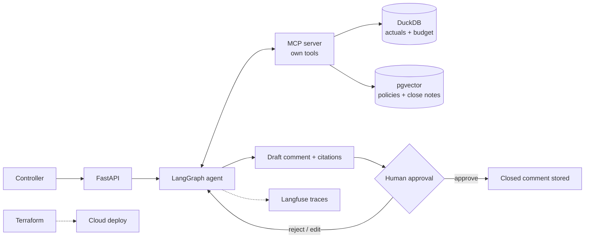

# finance-variance-agent

An agent that explains actual-vs-budget variances and drafts the close commentary. A human approves it.

> 🚧 Starting point — not built yet

## Problem
At month-end, finance teams compare actuals to budget. Then they write a comment for each large variance.
This is manual, repetitive and hard to audit. Numbers sit in one place, context (policies, close notes) in another.

## Users & scenario
- **User:** a financial controller at a fictional mid-size retail company.
- **Scenario:** after close, the controller asks "why is Marketing 12% over budget?". The agent finds the variance, explains it with cited context and drafts the comment. The controller edits, approves or rejects.
- **Data:** synthetic actuals and budget, plus synthetic policies and close notes. Public or generated only.

## Architecture

## Tech stack
| Block | Technology |
|---|---|
| **Production baseline** | FastAPI + Pydantic |
| | Evaluation: golden set + LLM-as-judge |
| | Guardrails (prompt injection, sensitive data) |
| | Langfuse (observability) |
| | pytest |
| | Docker |
| | GitHub Actions CI with quality gate |
| | Cloud deploy: TBD (AWS Bedrock or Azure OpenAI) |
| **Deep dive** | MCP: own server exposing the agent's tools |
| | Agents with tools: LangGraph |
| **Project-specific** | SQL tools over DuckDB |
| | Human-in-the-loop approval of the close comment |
| | Terraform for the infrastructure |

## Reuses
- The ingestion engine from the finance docs RAG project: read docs → chunk → embeddings → pgvector.
- Only the engine. Not its data.
- Here it loads policies and close notes, so each variance is explained with cited context.

## Definition of done
- [ ] MCP server runs on its own and exposes the SQL and retrieval tools; any MCP client can call them.
- [ ] The agent returns variance, drivers and cited sources for a given account and period.
- [ ] No comment is saved without explicit human approval (tested).
- [ ] Golden set of ≥ 30 cases runs in CI and blocks merge below the threshold.
- [ ] Guardrail tests cover prompt injection and read-only SQL (no write queries).
- [ ] Every run is traced in Langfuse (input, tool calls, output).
- [ ] `terraform plan` is clean and the service is deployed with a public demo.

## 5-day build plan
- **Day 1:** synthetic data in DuckDB, SQL tools, FastAPI skeleton.
- **Day 2:** load policies and close notes with the ingestion engine; retrieval tool.
- **Day 3:** MCP server and LangGraph agent with the human approval step.
- **Day 4:** golden set, LLM-as-judge, guardrails, Langfuse, pytest, CI quality gate.
- **Day 5:** Docker, Terraform, cloud deploy, README with real metrics.

## Metrics to report
- Variance explanation accuracy (golden set).
- Citation correctness (share of claims backed by a source).
- Approval rate: approved as-is vs edited vs rejected.
- Latency per request.
- Cost per request.
- Guardrail catch rate on adversarial cases.

## Run locally
_To be completed when built._
